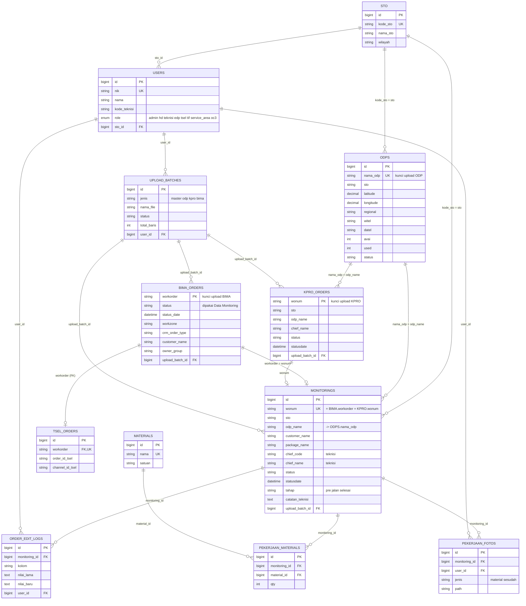

# ERD Database Magangsto

Tabel data dipisah per sumber file, lalu direlasikan lewat **kunci bisnis**:

| Relasi | Kunci |
|---|---|
| BIMA ↔ Data Monitoring ↔ KPRO | `bima_orders.workorder` = `monitorings.wonum` = `kpro_orders.wonum` |
| BIMA ↔ TSEL | `tsel_orders.workorder` → `bima_orders.workorder` (foreign key) |
| Order ↔ ODP | `monitorings.odp_name` = `odps.nama_odp` (juga `kpro_orders.odp_name`) |
| STO | `sto.kode_sto` = `monitorings.sto` = `odps.sto`; `users.sto_id` → `sto.id` |

Catatan:
- Tabel `monitorings` punya kolom `odp_id` (FK ke `odps.id`, nullable). Diisi otomatis dari kecocokan `monitorings.odp_name = odps.nama_odp` setiap selesai upload ODP / Data Master / KPRO.
- Kolom ODP di tabel `odps` bernama **nama_odp** (bukan `odp_name`) supaya berbeda dengan header file KPRO / Data Master. File ODP dari sumber memakai header `ODP_NAME`; saat upload ODP header itu otomatis dibaca sebagai `nama_odp`. File Master/KPRO tetap ditolak karena puluhan header lainnya bukan header ODP.
- `tsel_orders` hanya berisi WO yang **Order ID TSEL**-nya terisi di BIMA. WO yang tidak ada di tabel ini = non TSEL.
- Status yang tampil di Data Monitoring diambil dari `bima_orders.status`; WO yang belum ada di BIMA memakai `monitorings.status`.
- Setiap upload punya primary key: `workorder` (BIMA), `wonum` (KPRO dan Data Master), `nama_odp` (ODP). Upload ulang memperbarui baris yang kuncinya sama.

